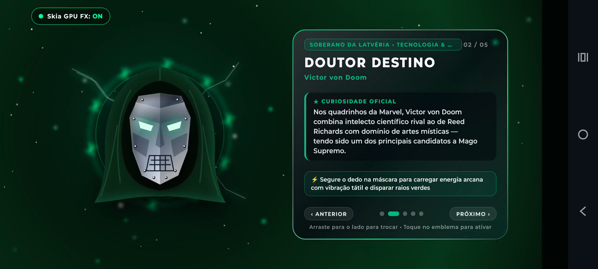
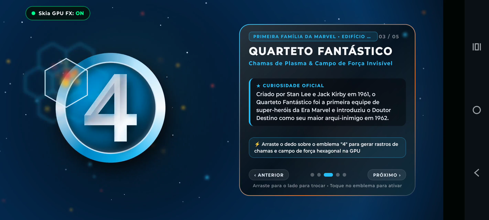
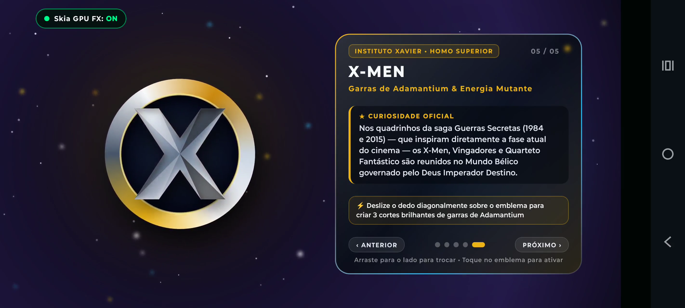

# ⚡ React Native Skia — O Poder da GPU no Mobile

> **Projeto prático da apresentação:** Experiência cinematográfica **Avengers: Doomsday (2026)** construída em **React Native + Expo** para demonstrar gráficos 2D acelerados diretamente na GPU com `@shopify/react-native-skia`.

---

## 🎨 O que é o React Native Skia? (Resumo & Pontos Importantes)

O **Skia** é uma engine gráfica 2D de código aberto (mantida pelo Google e usada no Chrome, Android e Flutter). O **`@shopify/react-native-skia`** traz esse motor para o React Native por meio de uma API declarativa em JSX (`<Canvas>`).

Enquanto a **GPU** é o hardware responsável por acender os pixels na tela (mas só entende comandos matemáticos), o **Skia atua como o "tradutor de arte 2D"**: ele converte formas, gradientes, textos, sombras e shaders em instruções otimizadas para a GPU (via **Metal** no iOS e **Vulkan / OpenGL ES** no Android).

### Pontos Importantes
- **Fluidez a 60 / 120 FPS:** Os cálculos e animações rodam fora da thread principal de JavaScript (via *Worklets* do Reanimated + JSI), evitando engasgos mesmo com centenas de elementos animados.
- **`<Canvas>` Declarativo:** Todo desenho Skia vive dentro do componente raiz `<Canvas>`, ligado diretamente à GPU.
- **Regra de Ouro (90% + 10%):** Use `StyleSheet`, `<View>` e `<Text>` tradicionais em ~90% do app (estrutura, listas, formulários, acessibilidade) e reserve o Skia (~10%) para gráficos, efeitos visuais avançados e interações ricas.
- **Ecossistema Integrado:** Funciona em sinergia com `react-native-reanimated`, `react-native-gesture-handler`, `expo-sensors` (giroscópio/acelerômetro) e `expo-haptics` (vibração tátil), além de bibliotecas de gráficos como `victory-native`.
- **Impacto no App:** Adiciona apenas cerca de **4 MB a 6 MB** ao tamanho do download, entregando em troca renderização nativa na GPU.
- **Uso em Produção:** Adotado por apps como **Shop (Shopify)**, **Rainbow Wallet**, **Notesnook**, **Runna** e **Rippling**.

---

## 🎤 Apresentação — Perguntas e Respostas

### Que problema ela resolve?
A interface tradicional do React Native (`<View>`, `<Text>`, `<Image>`) é excelente para telas comuns, mas **gargala na CPU** quando precisa animar dezenas ou centenas de elementos simultâneos e **não oferece nativamente** recursos visuais avançados como vidro fosco real (*backdrop blur*), sombras internas, neon/brilho difuso ou *shaders* programáveis. O React Native Skia resolve esse limite levando o desenho 2D complexo diretamente para a **GPU**, mantendo 60/120 FPS.

### Quais os principais recursos?
- **Formas Vetoriais e Caminhos (`Path`, `Circle`, `Rect`, `Group`):** Desenho procedural preciso e composição hierárquica na GPU.
- **Gradientes Avançados:** `LinearGradient`, `RadialGradient` e `SweepGradient` (cônico, ideal para reflexos metálicos).
- **Efeitos Visuais Cinematográficos:**
  - `BackdropBlur` (efeito vidro fosco / *glassmorphism* real em tempo real);
  - `BlurMask` (brilho neon e auras luminosas);
  - `Shadow` com `inner` (sombras internas e profundidade 3D).
- **Shaders Customizados (SkSL):** Efeitos líquidos, partículas, distorções e iluminação dinâmica pixel a pixel.
- **Integração Nativa com UI Thread:** Ligação direta com `SharedValue` do Reanimated e gestos do `GestureHandler`.

### Tem alguma limitação?
Sim — por ser um motor de desenho 2D em `<Canvas>`, existem pontos de atenção importantes:
1. **Sem Flexbox automático:** Dentro do `<Canvas>`, os elementos não usam `flex` — posições `x` e `y` precisam ser calculadas manualmente.
2. **Canvas é um bloco único:** Não há eventos de toque nativos (`onPress`) individuais em cada forma desenhada nem seleção de texto; toques exigem cálculo de coordenadas (*hit-test* manual) e o texto vira pixel (exigindo camadas de UI ou configuração extra para leitores de tela como TalkBack/VoiceOver, além de não ser indexável por SEO na Web).
3. **Tipografia:** Fontes exigem carregamento explícito (`useFont()`) ou integração com os motores de texto do sistema.
4. **Não é engine 3D nem player de vídeo:** O Skia não decodifica vídeos (MP4/H.264 — papel de `MediaCodec`/`ExoPlayer`) e não calcula câmera/profundidade 3D nativa (para 3D, trabalha em conjunto com motores como **TypeGPU**, fornecendo texturas 2D).

### Quais as principais diferenças entre recursos similares?
| Tecnologia | Foco Principal | Diferença em relação ao React Native Skia |
| :--- | :--- | :--- |
| **React Native Skia** | Gráficos 2D dinâmicos, filtros e *shaders* na GPU | Desenha e reage pixel a pixel em tempo real a 60/120 FPS com total controle programático. |
| **Lottie (`lottie-react-native`)** | Animações pré-exportadas (After Effects / JSON) | Ótimo para ícones e ilustrações prontas, mas **não** gera gráficos dinâmicos baseados em dados nem responde com *shaders* e física em tempo real. |
| **`react-native-svg`** | Vetores na árvore nativa | Cria cada forma como um elemento nativo separado; funciona bem para ícones estáticos, mas **gargala na CPU** ao animar muitos elementos simultâneos. |
| **Three.js / Filament / TypeGPU** | Engines 3D | Focadas em cenas 3D com câmera, malhas e profundidade; o Skia é especialista em **2D** (podendo gerar texturas 2D para o TypeGPU). |

---

## 📸 Capturas de Tela do App (Avengers: Doomsday — `Skia GPU FX: ON`)

| Doutor Destino (Máscara Metálica & Raios Arcanos) | Quarteto Fantástico (Plasma & Campo Hexagonal) | X-Men (Relevo Metálico & Partículas) |
| :---: | :---: | :---: |
|  |  |  |

---

## 🌌 Avengers: Doomsday (2026) — Experiência Cinematográfica em Modo Paisagem

Aplicação interativa cinematográfica em **React Native com Expo (100% compatível com Expo Go + TypeScript)** inspirada em **"AVENGERS: DOOMSDAY" (2026)**, utilizando:
- **`@shopify/react-native-skia`**: Renderização vetorial procedural acelerada na GPU (`SweepGradient`, `RadialGradient`, `LinearGradient`, `BlurMask`, `BackdropBlur`, `Shadow` com `inner`).
- **`react-native-reanimated`**: Animações a 60/120 FPS na UI Thread (`useSharedValue`, `useDerivedValue`, worklets nativas).
- **`react-native-gesture-handler`**: Navegação horizontal *parallax* por swipe (`Gesture.Pan`), toque (`Gesture.Tap`) e pressão longa (`Gesture.LongPress`).
- **`expo-screen-orientation`**: Travamento automático em **Modo Paisagem (`LANDSCAPE`)** ao abrir o app.
- **`expo-sensors` (`Gyroscope`)**: Reflexo metálico especular e parallax multicamadas controlados pela inclinação física do celular.
- **`expo-haptics`**: Feedback tátil sincronizado com cada poder e transição.

### 🖥️ Layout Dividido em Modo Paisagem (55% Palco | 45% Card Glassmorphism)
- **Lado Esquerdo (55% da largura):** Palco principal no `<Canvas>` do Skia onde fica o **emblema 3D/realista do personagem ou equipe**, matematicamente centralizado em `(cx, cy) = (stageWidth / 2, stageHeight / 2)`.
- **Lado Direito (45% da largura):** Card flutuante com efeito **vidro fosco (`<BackdropBlur blur={20}>`)**, borda metálica, curiosidade oficial e indicador de navegação.
- **Canto Superior Esquerdo (`Skia GPU FX: ON / OFF`):** Botão para demonstração técnica ao vivo (inicia em **OFF**), ligando/desligando gradientes metálicos, `SweepGradient`, `BlurMask`, `BackdropBlur` e partículas para comparar formas básicas 2D vs. gráficos acelerados pela GPU.

### 🎬 Os 5 Slides Interativos
1. **AVENGERS: DOOMSDAY (Logo Oficial):** Névoa cósmica verde-esmeralda, runas arcanas, emblema `"A"` metálico com `BlurMask` e onda de choque ao toque.
2. **DOUTOR DESTINO / VICTOR VON DOOM:** Máscara de aço escovado com rebites, olhos brilhantes e carregamento de energia arcana por pressão longa com `expo-haptics`.
3. **QUARTETO FANTÁSTICO:** Faíscas incandescentes de plasma, malha hexagonal translúcida e rastros de chamas ao arrastar o dedo sobre o `"4"`.
4. **CAPITÃO AMÉRICA:** Escudo de Vibranium com anéis metálicos (`SweepGradient`) e estrela trigonométrica que gira com faíscas ao toque.
5. **X-MEN:** Emblema `"X"` em relevo 3D metálico prateado/dourado com cortes brilhantes de garras de Adamantium ao deslizar o dedo.

---

## 🚀 Passo a Passo para Rodar o Projeto

### 1. Verificar dependências no PC (Windows)
```powershell
node -v
npm -v
git --version
```

### 2. Clonar o repositório e instalar pacotes
```powershell
git clone https://github.com/niickcodes/react-native-skia.git
cd react-native-skia
npm install
```

### 3. Iniciar o servidor para escanear o QR Code no Expo Go
```powershell
npx expo start --tunnel -c
```
- Se pedir para instalar `@expo/ngrok`, digite `y` e pressione Enter.
- Abra o **Expo Go** (SDK 58) no celular e escaneie o QR Code.
- **Plano B (mesma rede Wi-Fi):** rode `npx expo start -c`.
